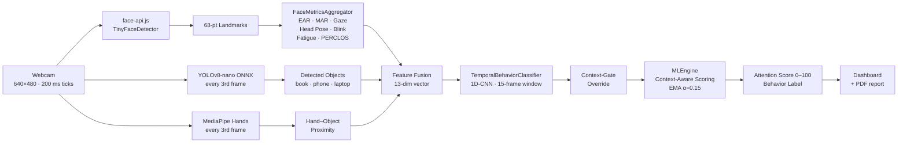
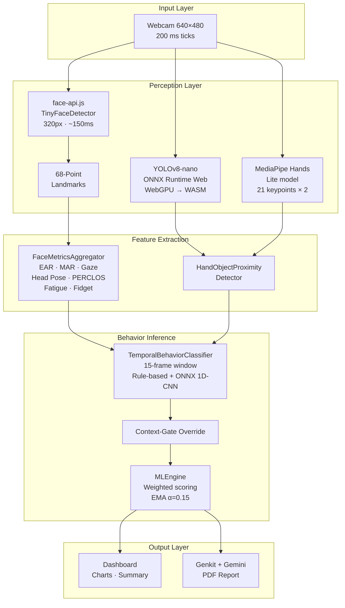
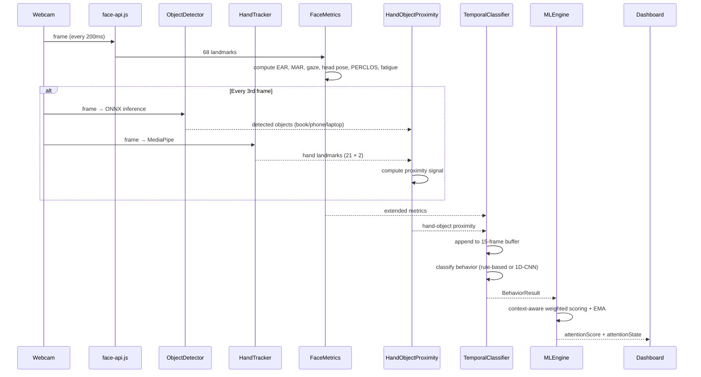
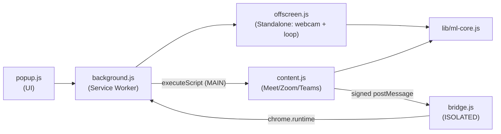

# AttentionTrackerOSS v1.0 — Browser-Native Cognitive Engagement Analyzer

> **Lead Developer & System Architect:** **Hrishikesh Jha** ([@hrishikeshjh](https://github.com/hrishikeshjh) · `hrishikeshjhapersonal@gmail.com`)  
> **Repository:** [AttentionTrackerOSS](https://github.com/hrishikeshjh/AttentionTrackerOSS)  
> **Subsystem:** Single-student, webcam-based real-time attention monitoring (Next.js 15 + Chrome MV3 Extension)  
> For the multi-person CCTV server version, see **[v2.0 README](v2.0/README.md)**. For the ESP32 hardware hub, see **[ESP32 README](esp32_relay_app/README.md)**.

---

## Table of Contents

1. [Overview](#1-overview)
2. [Key Features](#2-key-features)
3. [System Architecture](#3-system-architecture)
4. [ML Pipeline & Algorithms](#4-ml-pipeline--algorithms)
5. [Feature Extraction — Mathematical Foundations](#5-feature-extraction--mathematical-foundations)
6. [Object Detection Module (YOLOv8-nano)](#6-object-detection-module-yolov8-nano)
7. [Hand Tracking Module (MediaPipe Hands)](#7-hand-tracking-module-mediapipe-hands)
8. [Temporal Behavior Classifier (1D-CNN)](#8-temporal-behavior-classifier-1d-cnn)
9. [Context-Aware Scoring Engine](#9-context-aware-scoring-engine)
10. [Session Analytics Engine](#10-session-analytics-engine)
11. [Chrome Extension](#11-chrome-extension)
12. [Tech Stack](#12-tech-stack)
13. [Repository Structure](#13-repository-structure)
14. [Setup & Installation](#14-setup--installation)
15. [Configuration & Environment](#15-configuration--environment)
16. [Performance Metrics](#16-performance-metrics)
17. [Privacy](#17-privacy)
18. [References](#18-references)
19. [Cross-Reference: v2.0](#19-cross-reference-v20)
20. [Shared Scoring Core & Cross-Language Consistency](#20-shared-scoring-core--cross-language-consistency)
21. [Cross-Modal Contradiction Vector (Novel)](#21-cross-modal-contradiction-vector-novel)
22. [Testing, Linting & CI](#22-testing-linting--ci)
23. [Security & Dependency Hygiene](#23-security--dependency-hygiene)
24. [DACE — details](#24-dace-downward-attention-context-engine--details)

---

## 1. Overview

CognEn v1.0 is a **browser-based** cognitive engagement analyzer built on Next.js 15. It captures a 640×480 webcam feed (both web-app pipelines, legacy and the optional DACE mode, analyse on a fixed 200 ms `FixedTickScheduler` tick, i.e. a 5 FPS design rate, and record a prediction once per second; the 5 FPS rate is a design value, not a measured one: nothing has been run in a browser or against a camera), runs face detection via **face-api.js TinyFaceDetector**, extracts 68 facial landmarks, and computes a real-time **attention score (0–100)** using a weighted multi-feature ML engine with EMA temporal smoothing.

The upgraded v1.0 adds **context-aware scoring**: YOLOv8-nano object detection, MediaPipe hand tracking, and a 15-frame sliding-window temporal classifier distinguish reading a book (attentive) from using a phone (distracted) — eliminating the uniform downward-gaze penalty of the original system.



---

## 2. Key Features

| Feature | Description |
|---------|-------------|
| **Context-Aware Attention** | Distinguishes phone use from book reading via YOLOv8-nano + MediaPipe hand tracking |
| **Temporal Classification** | 1D-CNN sliding-window (15 frames / 3 s) with 6 behavior classes |
| **Context-Gate Override** | Hard rule post-processor resolving phone/book ambiguity below confidence threshold |
| **12+ Biometric Features** | EAR, MAR, PERCLOS, gaze deviation, head pose, blink rate, fatigue index, fidget score |
| **Live Dashboard** | Real-time line chart, pie chart, multitasking counter, session summary |
| **PDF Reports** | AI-generated session reports via Google Genkit + Gemini |
| **Chrome Extension** | Manifest V3, works inside Google Meet / Zoom / Teams via offscreen document |
| **DACE (opt-in, research)** | Context-conditioned looking-down penalty, desk-zone evidence, calibrated abstention ("Unsure", score held, never a penalty); off by default; see §24 |
| **Firebase Auth** | Email/password + Google Sign-in (Firestore is initialised but no session data is currently written to it) |

**Novelty list (ten items).** (1) Context-Gate Override; (2) asymmetric ConfusionPenaltyLoss (v2.0 training); (3) context-aware scoring + AR(1) temporal fusion; (4) prioritized Seat Mapping (v2.0); (5) Fatigue Onset detection; (6) Cross-Modal Contradiction Vector (CMCV, §21); and the four DACE items: (7) context-conditioned looking-down penalty (gaze-corrected, evidence-gated); (8) calibrated abstention with reason codes U1-U5 and a score-hold policy (rules in Stage 1, conformal in Stage 2); (9) webcam eye-kinematics for reading with the head pitched down (Stage 2, go/no-go; a feasibility study, forced off in Stage 1); (10) the FDR-DA metric and benchmark (false distraction during reading/note-taking). Items 7-10 are implemented (7, 8, 10) or stubbed (9) and unit-tested only; no result for any of them has been measured. Items 1, 3 and 6 were degraded on the legacy path by the pitch/gaze/detector defects (see §24); their claims stay targets until measured on pilot set P1 / dataset D1.

---

## 3. System Architecture

### 3.1 High-Level Data Flow



### 3.2 Sequence Diagram — Single Frame Processing



---

## 4. ML Pipeline & Algorithms

### 4.1 Two Scoring Modes

The MLEngine automatically selects its scoring mode:

| Mode | Condition | Features | Weights |
|------|-----------|----------|---------|
| **LEGACY** | `detectedObjects === undefined` | 13 features incl. uniform `pitchDeviation` | `FEATURE_WEIGHTS_LEGACY` |
| **UPGRADED** | `detectedObjects !== undefined` | 16 features: replaces `pitchDeviation` with `contextAwarePitch`, `objectContext`, `handObjectProximity`, `temporalPattern` | `FEATURE_WEIGHTS_V1_UPGRADED` |

Both paths are reachable in the web app: `webcam-panel.tsx` keeps the object detector only if the YOLO model actually loaded (`od.isLoaded()`), so a missing `/models/yolov8n-objects.onnx` yields the LEGACY weights. The web app builds its engine with `APP_ENGINE_OPTIONS` (`cmcvTaxonomy: 'v2'`, `contributionWeights: 'used'`), which only changes explanatory outputs (feature contributions, CMCV category), never `rawScore`, state or confidence; a bare `new MLEngine()` keeps the frozen as-shipped behaviour that `legacy-equivalence.test.ts` and replay presets A/A' use. When no face is present for `ABSENCE_GRACE_MS` (3 s), `MLEngine.predictAbsent()` records an `Idle` tick scored 0 through the EMA, so absence lowers the session average.

### 4.2 Upgraded Feature Weights

| Feature | Weight | Role |
|---------|--------|------|
| gazeDeviation | 0.12 | Primary attention signal |
| contextAwarePitch | 0.12 | Pitch gated by object context |
| objectContext | 0.10 | What objects are visible |
| headPoseStability | 0.10 | Overall engagement |
| ear | 0.10 | Eye openness |
| perclos | 0.08 | Drowsiness |
| yawDeviation | 0.08 | Looking left/right |
| fatigueIndex | 0.07 | Accumulated fatigue |
| blinkRate | 0.05 | Eye strain indicator |
| handObjectProximity | 0.05 | Hand-object interaction |
| fidgetScore | 0.04 | Restlessness |
| temporalPattern | 0.03 | Temporal consistency bonus |
| mouthOpenness | 0.02 | Yawning detection |
| faceDistance | 0.02 | Proximity to camera |
| facePresence | 0.02 | Face in frame |

### 4.3 Score Computation

```
For each feature:
  score_i = scoreFeature(name, value)    // → 0–100
  quality_i = getQuality(name, value)    // → 0–1

Weighted combination:
  raw = Σ(score_i × weight_i × quality_i) / Σ(weight_i × quality_i)

EMA smoothing:
  smoothed = α × raw + (1 − α) × prev_smoothed    (α = 0.15)

Classification:
  ≥ 70 → Attentive
  ≥ 40 → Distracted
  < 40 → Multitasking
```

---

## 5. Feature Extraction — Mathematical Foundations

### 5.1 Eye Aspect Ratio (EAR)

```
EAR = (‖p2−p6‖ + ‖p3−p5‖) / (2 × ‖p1−p4‖)
```

| EAR Value | Interpretation |
|-----------|----------------|
| 0.30–0.40 | Fully open |
| 0.25–0.30 | Normal |
| 0.21–0.25 | Partially closed |
| < 0.21 | Blink / closed |

Blink detection: EAR drops below 0.21 then rises back, duration 50–500 ms.

### 5.2 PERCLOS (Percentage Eye Closure)

```
PERCLOS = (frames with EAR < 0.21) / (total frames in last 60s) × 100%
```

| PERCLOS | Interpretation |
|---------|----------------|
| < 15% | Alert |
| 15–30% | Mildly fatigued |
| > 30% | Drowsy |

### 5.3 Mouth Aspect Ratio (MAR)

```
MAR = ‖top_lip − bottom_lip‖ / ‖left_corner − right_corner‖
```

| MAR | Interpretation |
|-----|----------------|
| < 0.10 | Mouth closed |
| 0.10–0.25 | Speaking |
| > 0.25 | Yawning |

### 5.4 Head Pose Estimation

> **Updated formula** (see [§20](#20-shared-scoring-core--cross-language-consistency)): yaw and pitch now share the **same normalizer** (interocular distance) instead of pitch using nose-chin distance. Nose-chin distance foreshortens as the head pitches, which biased the old pitch signal against itself at extreme angles — using interocular distance for both keeps the normalizer stable as pitch varies. Implementation: `v1.0/src/lib/scoring/pose/head-pose.ts`.

```
Yaw   = ((nose.x − eye_midpoint.x) / eye_distance) × 50
Pitch = ((nose.y − eye_midpoint.y) / eye_distance) × 33.3   (legacy; defective, see §24)
Roll  = atan2(right_eye.y − left_eye.y, right_eye.x − left_eye.x) × (180/π)
```

The gain constants (50, 33.3) are empirically calibrated to keep output magnitude compatible with existing downstream thresholds (e.g. the "pitch < -15°" branch in §9.1) rather than representing true degrees — a full `solvePnP`-based 3D pose upgrade is a documented future option, not implemented (avoided pulling in OpenCV.js's ~8MB WASM bundle for it).

**Stability Score** (variance over 30-second window):
```
Stability = 100 − (σ²_yaw + σ²_pitch + 0.5 × σ²_roll) / 2.5 / 10
```

### 5.5 Gaze Direction

```
Gaze_X = ((iris_center.x − eye_center.x) / eye_width − 0.5) × 2
Gaze_Y = (eye_center.y − iris_center.y) / eye_height
Deviation = √(Gaze_X² + Gaze_Y²)
```

| Deviation | Interpretation |
|-----------|----------------|
| < 0.15 | Looking at screen |
| 0.15–0.30 | Slight glance |
| > 0.30 | Looking away |

### 5.6 Fatigue Index

Composite of three sub-scores (0–100):
```
PERCLOS_score   = clamp(avg_PERCLOS × 2, 0, 40)
Blink_score     = penalty if outside 15–20 bpm range (max 30)
EAR_trend_score = penalty if avg_EAR < 0.25 (max 30)
Fatigue_Index   = clamp(PERCLOS_score + Blink_score + EAR_trend_score, 0, 100)
```

### 5.7 Fidget Score

```
Movement = Σ|Δyaw| + |Δpitch| + |Δroll| over recent frames
Fidget   = clamp(avg_movement × 5, 0, 100)
```

---

## 6. Object Detection Module (YOLOv8-nano)

**Model**: YOLOv8-nano (3.2M params) via ONNX Runtime Web (WebGPU → WASM fallback)

| Property | Value |
|----------|-------|
| Input | `[1, 3, 640, 640]` float32, NCHW, normalized [0,1] |
| Output | `[1, 84, 8400]` (cx cy w h + 80 COCO class scores) |
| Confidence threshold | 0.25 |
| NMS IoU threshold | 0.45 |
| Inference cadence | Every 3rd frame |
| Target classes | laptop(63), mouse(64), keyboard(66), phone(67), book(73) |

**Post-processing**: Class-aware NMS — only suppresses overlapping boxes within the same class.

---

## 7. Hand Tracking Module (MediaPipe Hands)

| Property | Value |
|----------|-------|
| Model | MediaPipe Hands Lite (complexity 0) |
| Max hands | 2 |
| Landmarks | 21 per hand (normalized [0,1]) |
| Cadence | Every 3rd frame (same as ObjectDetector) |
| Min detection confidence | 0.5 |

**HandObjectProximityDetector** fuses hand centroids with object bounding boxes:
- Proximity threshold: 0.20 (normalized Euclidean distance)
- Priority order: `phone > book/notebook > pen`
- Output labels: `holding_phone`, `holding_book`, `holding_pen`, `hands_on_desk`, `hands_not_visible`

---

## 8. Temporal Behavior Classifier (1D-CNN)

### 8.1 Feature Vector (13 dimensions per frame)

| Index | Feature | Range |
|-------|---------|-------|
| 0 | gaze_x | [-1, 1] |
| 1 | gaze_y | [-1, 1] |
| 2 | pitch_norm (pitch/90) | [-1, 1] |
| 3 | yaw_norm (yaw/90) | [-1, 1] |
| 4 | ear | [0, 1] |
| 5 | perclos/100 | [0, 1] |
| 6 | head_pose_stability/100 | [0, 1] |
| 7 | has_book (one-hot) | {0, 1} |
| 8 | has_phone (one-hot) | {0, 1} |
| 9 | has_laptop (one-hot) | {0, 1} |
| 10 | has_none (one-hot) | {0, 1} |
| 11 | fidget_score/100 | [0, 1] |
| 12 | proximity_code | [0, 1] |

### 8.2 Behavior Classes

| Class | Attention Score | Description |
|-------|----------------|-------------|
| `attentive_screen` | 85 | Watching lecture / screen |
| `attentive_reading` | 80 | Reading book / notes |
| `distracted` | 45 | Looking around, talking |
| `using_phone` | 25 | Phone distraction |
| `drowsy` | 20 | Head down + low EAR |
| `absent` | 0 | Face not in frame |

### 8.3 Two-Tier Classification

1. **Rule-based fallback** — always available, used when < 15 frames buffered or no ONNX model
2. **ONNX 1D-CNN** — trained model loaded via `loadModel()`, input `[1, 15, 13]`

### 8.4 Rule-Based Decision Tree

```
1. face_area < 0.005         → absent     (conf 1.0)
2. EAR < 0.22 AND PERCLOS > 20 → drowsy   (conf 0.85)
3. phone + (holding OR looking down) → using_phone (conf 0.80)
4. book + (holding OR looking down) → attentive_reading (conf 0.75)
5. gaze_deviation < 0.3 AND |pitch| < 15° → attentive_screen (conf 0.70)
6. else → distracted (conf 0.60)
```

---

## 9. Context-Aware Scoring Engine

### 9.1 Context-Aware Pitch Score

Replaces the uniform pitch penalty (on the legacy path the `pitch < -15°` branch is effectively unreachable because of the pitch defect in §24; DACE mode feeds corrected, negated values):

```
if pitch < -15°:
    if phone detected or holding_phone → 20 (distracted)
    if book detected or holding_book  → 85 (attentive)
    if EAR < 0.22 and PERCLOS > 20   → 15 (drowsy)
    else                              → 40 (unknown)
else:
    standard pitch scoring based on deviation from optimal ±15°
```

### 9.2 Object Context Score

```
No objects       → 65 (neutral)
Phone visible    → 25
Book + pitch<-10 → 80
Book (other)     → 70
Laptop + |pitch|<15 → 80
Other            → 65
```

### 9.3 Hand Proximity Encoding

| Proximity | Score |
|-----------|-------|
| holding_book | 80 |
| holding_pen | 75 |
| hands_on_desk | 65 |
| hands_not_visible | 60 |
| holding_phone | 20 |

---

## 10. Session Analytics Engine

Uses **linear regression** for trend detection, sliding windows for period identification.

| Algorithm | Purpose |
|-----------|---------|
| Linear regression (OLS) | Attention trend (slope + R²) |
| Period detection | Find contiguous high (≥75) / low (≤45) periods |
| Fatigue onset detection | Sustained declining slope (< -0.5) + R² > 0.4 + avg < 60 |
| Anomaly detection | Z-score > 2.5 σ from mean; sudden drops > 30 points |
| Optimal window | Sliding window finding highest average attention period |

---

## 11. Chrome Extension

**Manifest V3** extension with dual-mode operation. Full details (permissions, messaging channel, video selection, settings): [`extension/README.md`](v1.0/extension/README.md).



| Mode | When | How |
|------|------|-----|
| **Meet / Zoom / Teams mode** | On a supported call tab | Background injects `face-api`, `ml-core.js` and `content.js` into the page MAIN world and `bridge.js` into the isolated world; the analyser picks the self-view `<video>` (live local-capture track, else mirrored element, else largest) |
| **Standalone** | Any other tab | Offscreen document with its own `getUserMedia` camera access |

**Parity with the web app.** `extension/lib/ml-core.js` (an IIFE exposing `window.__cognen`) is a plain-JS port of `src/lib/scoring/` and the legacy `MLEngine` path: same blink/fatigue/fidget constants, EMA α = 0.15, predictions once per second, thresholds 70/40 (popup ring, badge, widget and README all use the same bands). It has no object detector or hand tracker, so both modes score with `FEATURE_WEIGHTS_LEGACY`. `src/lib/__tests__/extension-equivalence.test.ts` loads `ml-core.js` in node and compares it with the TypeScript modules on synthetic landmark sequences. This is a unit test only: **the extension has not been loaded in Chrome or run against a camera.** The legacy pitch defect (§24) applies here too.

**Cadence.** Frames are analysed on a fixed 200 ms `setTimeout` tick (not `requestAnimationFrame`, which is paused in hidden/offscreen documents); one prediction per second goes to the background, which owns the badge, the session record (`chrome.storage.session`, with `local` as fallback), alerts (`chrome.alarms` + `notifications`; default alert threshold 40, break reminder 45 min).

**Security.** `host_permissions` and `web_accessible_resources` are limited to `meet.google.com`, `*.zoom.us` and `teams.microsoft.com`. The in-page analyser shares the page's MAIN world, so its messages are HMAC-signed with a per-session key delivered via `executeScript` args, verified and replay-checked in `bridge.js`, then relayed with `chrome.runtime.sendMessage`; the page-`localStorage` channel is gone. Page scripts can still read the posted messages and tamper with injected globals (see `extension/README.md`).

---

## 12. Tech Stack

| Layer | Technology |
|-------|------------|
| Framework | Next.js 15 (App Router, Turbopack) |
| Face detection | face-api.js TinyFaceDetector (320px, ~150ms) |
| Landmarks | face-api.js 68-point model (iBUG convention) |
| Object detection | YOLOv8-nano ONNX via `onnxruntime-web` (WebGPU → WASM) |
| Hand tracking | MediaPipe Hands Lite (`@mediapipe/hands`) |
| Temporal classifier | Rule-based + ONNX 1D-CNN |
| Auth | Firebase Auth (Firestore is initialised in `firebase.ts` but nothing is read or written) |
| AI report | Google Genkit + Gemini (PDF generation) |
| Charts | Recharts |
| UI components | Radix UI + Tailwind CSS |
| Extension | Chrome MV3 + offscreen document |

---

## 13. Repository Structure

```
v1.0/
├── src/
│   ├── lib/
│   │   ├── scoring/                # Single-source-of-truth scoring core (see §20)
│   │   │   ├── constants.ts        #   Thresholds, feature weights, calibration constants
│   │   │   ├── geometry.ts         #   distance/variance/stddev/clamp helpers
│   │   │   ├── ear-mar.ts          #   EAR/MAR formulas
│   │   │   ├── pose/head-pose.ts   #   Corrected head-pose (shared normalizer)
│   │   │   ├── pose/gaze.ts        #   Gaze direction estimation
│   │   │   ├── trackers.ts         #   BlinkDetector, HeadPoseTracker, FatigueCalculator
│   │   │   ├── aggregator.ts       #   FaceMetricsAggregator, HandObjectProximityDetector
│   │   │   ├── face-selection.ts   #   PrimaryFaceSelector (multi-face handling, see §20)
│   │   │   ├── ema.ts              #   ExponentialMovingAverage
│   │   │   ├── VERSION.ts          #   SCORING_CORE_VERSION (bumped on formula changes)
│   │   │   └── __tests__/          #   Vitest unit + regression tests
│   │   ├── scoring/dace/           # DACE pure core (node-testable; see §24, ARCHITECTURE.md §11)
│   │   ├── dace/                   # DACE browser layer: config, presets, providers, engine, scheduler, eval-log
│   │   ├── contradiction-detector.ts # Cross-Modal Contradiction Vector (see §21)
│   │   ├── types.ts               # Core types: ExtendedFaceMetrics, BehaviorResult, etc.
│   │   ├── face-geometry.ts       # Re-export shim over scoring/ (kept for import compatibility)
│   │   ├── ml-engine.ts           # MLEngine: context-aware scoring, consumes scoring/constants.ts
│   │   ├── object-detector.ts     # YOLOv8-nano ONNX wrapper (browser)
│   │   ├── hand-tracker.ts        # MediaPipe Hands wrapper (browser)
│   │   ├── temporal-classifier.ts # 1D-CNN sliding-window classifier (browser)
│   │   ├── analytics.ts           # SessionAnalyticsEngine
│   │   └── firebase.ts            # Firebase config (env-var driven, see §15)
│   ├── components/
│   │   ├── dashboard/             # Webcam panel, charts, session summary
│   │   ├── auth-form.tsx          # Login / signup
│   │   └── ui/                    # Radix UI primitives
│   ├── app/
│   │   ├── page.tsx               # Landing / auth page
│   │   ├── dashboard/             # Main dashboard route
│   │   ├── replay/                # Research-only /replay page (404 unless NEXT_PUBLIC_DACE_RESEARCH=1)
│   │   ├── error.tsx              # Client error boundary (see §22)
│   │   ├── global-error.tsx       # Root-layout error boundary
│   │   └── globals.css            # Global styles
│   ├── ai/flows/                  # Genkit flow (generate-session-summary.ts; the unused analyze-facial-features flow was removed)
│   ├── lib/server/                # Report-action security: firebase-id-token.ts (ID-token verify), rate-limit.ts, report-input.ts (zod), report-request.ts
│   └── hooks/                     # React hooks
├── extension/
│   ├── lib/ml-core.js             # IIFE port of scoring/ + legacy MLEngine (equivalence-tested, see §11)
│   ├── lib/face-api.min.js        # bundled @vladmandic/face-api (weights from jsDelivr CDN)
│   ├── offscreen.js               # Offscreen document: webcam + face-api.js (200 ms setTimeout tick)
│   ├── background.js              # Service worker: session record, badge, alarms, notifications
│   ├── content.js                 # MAIN-world analyser + widget for Meet/Zoom/Teams
│   ├── bridge.js                  # ISOLATED-world relay (verifies HMAC, forwards to background)
│   ├── popup/                     # Popup UI
│   └── manifest.json              # Chrome MV3 manifest (host_permissions narrowed, see §23)
├── public/
│   ├── models/                    # face-api.js weights
│   └── onnx/                      # onnxruntime-web WASM binaries
├── scripts/
│   ├── patch-genkit-otel2.mjs     # postinstall: adapts genkit to the OpenTelemetry 2.x forced by overrides (§23)
│   ├── stubs/extract-zip/         # local stub that replaces the extract-zip dependency (§23)
│   ├── setup-models.sh            # Copies ORT WASM; downloads + sha256-verifies MediaPipe models
│   ├── models.sha256              # Checksums verified by setup-models.sh
│   └── dace/                      # replay-features.ts, metrics.ts, cvat-windows.ts (DACE evaluation tooling)
├── eslint.config.mjs              # ESLint flat config (next/core-web-vitals + typescript-eslint)
├── vitest.config.ts               # Vitest test runner config
├── .env.example                   # placeholder environment template (§15)
├── package.json
├── next.config.ts
├── postcss.config.mjs             # Tailwind 4 via @tailwindcss/postcss (no tailwind.config.ts)
└── tsconfig.json
```

---

## 14. Setup & Installation

### Prerequisites
- Node.js 24 (what CI and the local verification use; `package.json` declares no `engines` field)
- Firebase project (Auth; Firestore is initialised but unused)
- Google AI API key (Genkit / Gemini)

### Steps

```bash
# 1. Install dependencies
cd v1.0 && npm install

# 2. Environment variables
cp .env.example .env.local
# Edit with Firebase + Genkit keys (see §15)

# 3. ONNX Runtime WASM binaries
bash scripts/setup-models.sh

# 4. YOLOv8-nano model (on a machine with Ultralytics)
python3 -c "from ultralytics import YOLO; YOLO('yolov8n.pt').export(format='onnx', imgsz=640, opset=17, simplify=True)"
cp yolov8n.onnx v1.0/public/models/yolov8n-objects.onnx

# 5. Dev server
npm run dev    # → http://localhost:9002

# 6. Chrome Extension (optional)
# chrome://extensions → Developer mode → Load unpacked → select extension/
```

### Available Commands

```bash
npm run dev           # Dev server (Turbopack, port 9002)
npm run build         # Production build
npm run lint          # ESLint
npm run typecheck     # TypeScript type check
npm run genkit:dev    # Genkit AI dev server
npm test              # Vitest unit tests (incl. legacy-equivalence and DACE suites)
```

### DACE (research, optional)

DACE (Downward-Attention Context Engine) is an opt-in research path that corrects head-pose/gaze/eye-openness measurement, adds desk-zone evidence, applies ordered temporal rules and can output "Unsure" instead of guessing. Full design, parameters, rule order and pending decisions: [ARCHITECTURE.md §11](ARCHITECTURE.md#11-dace-downward-attention-context-engine-v10-only). **DACE is off by default and the default path is unchanged**: a golden-fixture test (`src/lib/__tests__/legacy-equivalence.test.ts`) checks that with DACE off the legacy pipeline reproduces its pre-DACE output exactly. All DACE numbers are targets or initial parameters; nothing has been measured on real data yet.

> **Implementation status**: the DACE engine, providers, dashboard integration, `/replay` page, scripts and model setup are implemented and unit-tested in node with mocked browser libraries. They have **not** yet been run in a browser, on a camera or on a recording, so MediaPipe loading, latency and accuracy are unverified.

```bash
# 1. Dependencies (includes @mediapipe/tasks-vision)
npm install

# 2. Models: download pinned face_landmarker.task, hand_landmarker.task and
#    efficientdet_lite0.tflite, copy the tasks-vision WASM to public/mediapipe/wasm,
#    verify scripts/models.sha256. The YOLOv8 model is AGPL-3.0 (research use only,
#    decision R2); the script prints instructions for it instead of downloading it.
bash scripts/setup-models.sh

# 3. Enable DACE with a preset (A, A', A'', B, C, F, H, I) in .env.local ...
NEXT_PUBLIC_DACE_PRESET=F
#    ... or with individual flags, e.g.
NEXT_PUBLIC_DACE_ENABLED=true
NEXT_PUBLIC_DACE_MEASUREMENT=mediapipe

# 4. Research overrides (honoured only when NEXT_PUBLIC_DACE_RESEARCH=1):
#    http://localhost:9002/dashboard?dace=F,log=windows
#    or localStorage['cognen.dace'] = "F,log=windows"

# 5. Replay page: http://localhost:9002/replay
#    research builds only (404 unless NEXT_PUBLIC_DACE_RESEARCH=1), local files only

# 6. Offline re-run of evidence/rules/abstention from a frame log (record with log=frames)
npm run dace:replay -- --frames rec__F.jsonl --preset F --preset H --out out/
#    Metrics against CVAT labels:
#    npx tsx scripts/dace/cvat-windows.ts --xml ann.xml --fps 30 --recording rec --out gt.jsonl
#    npx tsx scripts/dace/metrics.ts --labels gt.jsonl --log rec=out/rec__F__offline_F.jsonl --preset F

# 7. Tests
npm test
```

---

## 15. Configuration & Environment

Copy `.env.example` to `.env.local` and fill in real values:

```
NEXT_PUBLIC_FIREBASE_API_KEY=...
NEXT_PUBLIC_FIREBASE_AUTH_DOMAIN=...
NEXT_PUBLIC_FIREBASE_PROJECT_ID=...
NEXT_PUBLIC_FIREBASE_STORAGE_BUCKET=...
NEXT_PUBLIC_FIREBASE_MESSAGING_SENDER_ID=...
NEXT_PUBLIC_FIREBASE_APP_ID=...
GEMINI_API_KEY=...
```

> **Note on the Firebase variables**: these are the Firebase Web SDK's public client config (`src/lib/firebase.ts`) — not secret. Access control is enforced by Firestore/Auth security rules, not by hiding these values. They're env-driven for environment flexibility (dev/staging/prod Firebase projects) rather than for secrecy. `next.config.ts` declares these vars explicitly (`env:` block) so they're available at build time.
>
> `GEMINI_API_KEY` (or `GOOGLE_API_KEY`, either name works) **is** secret — used by `src/ai/genkit.ts`'s `googleAI()` plugin for Gemini access. Get one from [Google AI Studio](https://aistudio.google.com/apikey). Never commit a real value.
>
> `FIREBASE_PROJECT_ID` (optional, server only) is the project whose ID tokens the report server action accepts; it defaults to `NEXT_PUBLIC_FIREBASE_PROJECT_ID`.
>
> **Authentication model.** The dashboard's sign-in guard (`src/app/dashboard/layout.tsx`) runs in the browser: Firebase client auth lives in the browser, so Next.js middleware cannot see it without a session cookie, and the guard only controls what UI is shown. The one server-side resource, the report export (`generateReportAction` in `src/app/actions.ts`), authenticates every call itself: the client sends its Firebase ID token, which is verified against Google's public signing keys (`src/lib/server/firebase-id-token.ts`, `node:crypto`, no extra dependency), then the call is rate-limited per user (5 per 10 min per server instance) and its input strictly validated before Gemini is called.
>
> Deployed via Firebase App Hosting: see `apphosting.yaml`, which declares the public Firebase vars directly and documents referencing `GEMINI_API_KEY` via `firebase apphosting:secrets:set` rather than plaintext.

**DACE variables (all optional; DACE is off when none are set).** Read by `src/lib/dace/config.ts`. `PRESET` is applied first, then the individual flags override it. Invalid values are ignored with a warning.

| Variable | Values | Config key |
|----------|--------|------------|
| `NEXT_PUBLIC_DACE_PRESET` | `A`, `A'` (`A1`), `A''` (`A2`), `B`, `C`, `F`, `H`, `I` | ablation preset |
| `NEXT_PUBLIC_DACE_ENABLED` | `true` / `false` | `enabled` |
| `NEXT_PUBLIC_DACE_MEASUREMENT` | `legacy` / `pnp68` / `mediapipe` | `measurement` |
| `NEXT_PUBLIC_DACE_EVIDENCE` | `true` / `false` | `evidence` |
| `NEXT_PUBLIC_DACE_RULES` | `true` / `false` | `rules` |
| `NEXT_PUBLIC_DACE_ABSTAIN` | `off` / `rules` / `conformal` (Stage 2; degrades to `rules`) | `abstain` |
| `NEXT_PUBLIC_DACE_DETECTOR` | `yolo` / `mediapipe` | `detector` |
| `NEXT_PUBLIC_DACE_KINEMATICS` | `off` / `on` (Stage 2; forced `off`) | `kinematics` |
| `NEXT_PUBLIC_DACE_TEMPORAL_MODEL` | `rules` / `onnx` (Stage 2) | `temporalModel` |
| `NEXT_PUBLIC_DACE_BASELINE` | `internal` / `peb` (PEB is interface-only) | `baseline` |
| `NEXT_PUBLIC_DACE_LOG` | `off` / `windows` / `frames` | `log` |
| `NEXT_PUBLIC_DACE_SHUFFLE_OBJECTS` | `true` / `false` | `replay.shuffleObjects` |
| `NEXT_PUBLIC_DACE_RESEARCH` | `1` to allow `?dace=` / `localStorage['cognen.dace']` overrides, the `/replay` page, the research badge, and the eval-log download / latency panel on the dashboard | (gate only) |
| `NEXT_PUBLIC_DACE_YOLO_SHA256` | optional lowercase SHA-256 of your `yolov8n-objects.onnx`; when set, the browser verifies the model before use | (detector load) |

See [ARCHITECTURE.md §11](ARCHITECTURE.md#11-dace-downward-attention-context-engine-v10-only) for what each flag does, the resolution order and the presets. The resolved config is frozen for the session, and its hash plus `DACE_VERSION` is stamped on every evaluation-log record.

---

## 16. Performance Metrics

| Metric | Value |
|--------|-------|
| Frame rate | Both pipelines: fixed 200 ms `FixedTickScheduler` tick (5 FPS design rate; a tick that arrives while the previous one is running is dropped, never queued), prediction recorded at 1 Hz. Design values, not measured |
| Face detection | TinyFaceDetector, 320px input, ~150ms |
| Memory | ~50MB for face-api models |
| CPU usage | ~15–25% on modern hardware |
| Latency target | < 200ms/frame |
| Object detection | ~15ms/frame (WebGPU) |

### Accuracy Limitations

- Poor lighting reduces landmark accuracy
- Extreme head angles (>40°) lose tracking
- Reflective glasses affect gaze estimation
- Gaze estimation approximates iris position from eyelid landmarks (face-api.js's 68-point model has no true iris landmarks) — cannot detect eyes-only glances without head movement. A MediaPipe FaceMesh iris migration is scoped as a future upgrade (`TODO(gaze-v2)` in `scoring/pose/gaze.ts`), not yet implemented.
- **Multi-face handling (updated)**: previously only the first detected face (`detections[0]`, detector-order-dependent) was tracked, which could silently flip identity frame-to-frame with a second face in view. Now uses `PrimaryFaceSelector` (§20): locks onto the largest, most-centered face with identity-continuity hysteresis, so a transient false detection or a momentary size fluctuation doesn't cause flicker.
- Low-res cameras reduce accuracy

---

## 17. Privacy

1. **Video stays local** — no frames are sent to any server (the optional report export does send derived statistics, see item 5)
2. **No raw video stored** — only derived scores persisted
3. **Extension data** — stored locally in Chrome's storage
4. **Firebase** — currently only Firebase Auth is used; no session data is written to Firestore
5. **Report generation** — when you export a report, the session summary (derived scores and statistics, no frames) is sent to the Genkit/Gemini report generator; the request is only accepted with a valid Firebase ID token
6. **DACE evaluation logs** (research builds only) — no images, no user id, random session id, manual download only; a data-retention limit is still to be implemented

---

## 18. References

- **EAR**: Soukupová & Čech (2016) — *Real-Time Eye Blink Detection using Facial Landmarks*
- **PERCLOS**: Dinges & Grace (1998) — *PERCLOS: A Valid Psychophysiological Measure of Alertness*
- **face-api.js**: https://github.com/vladmandic/face-api
- **68-Point Landmarks**: iBUG 300-W dataset standard
- **YOLOv8**: Ultralytics (2023) — https://github.com/ultralytics/ultralytics
- **MediaPipe Hands**: Google (2020) — https://developers.google.com/mediapipe

---

## 19. Cross-Reference: v2.0

v1.0's *legacy* per-person math is **hand-ported into v2.0** (not shared code; DACE is not ported). See the [v2.0 README](v2.0/README.md) for the multi-person CCTV server system.

| Component | v1.0 | v2.0 |
|-----------|------|------|
| Face detection | face-api.js | YOLOv8-m + MediaPipe FaceMesh |
| 68-pt landmarks | face-api.js | MediaPipe → ibug mapping |
| EAR/MAR/Gaze/HeadPose | TypeScript (browser) | Python port |
| Object detection | YOLOv8-nano (ONNX.js) | YOLOv8-s (Ultralytics) |
| Hand tracking | MediaPipe Hands (browser) | Pose covers this |
| Temporal classifier | 1D-CNN (browser ONNX) | 1D-CNN (server ONNX) |
| Tracking | Single person | ByteTrack multi-person |
| Seat mapping | N/A | Shapely polygon IoU |
| Deployment | Browser / Chrome Extension | FastAPI + GPU server |

---

## 20. Shared Scoring Core & Cross-Language Consistency

Historically, the web app (`ml-engine.ts`/`face-geometry.ts`), the Chrome extension (`extension/lib/ml-core.js`), and v2.0's Python port (`features/face_metrics.py`) each independently drifted: different attention thresholds (70/40 vs 80/50), different gaze multipliers (2× vs 3×), different head-pose normalizers, different stability-variance divisors. Since v2.0 reuses this math per tracked person, these bugs propagated and multiplied across every student in a room.

**Fix**: `v1.0/src/lib/scoring/` is now the single source of truth for all face-geometry math (EAR/MAR, head pose, gaze, blink/fatigue/stability trackers, feature scoring, multi-face selection). `face-geometry.ts` and `ml-engine.ts` are now thin re-export shims over it, so existing `@/lib/face-geometry` and `@/lib/ml-engine` imports keep working unchanged.

**Extension sync**: the Chrome extension (plain JS, no TS build step) carries a hand-written port of the formulas (`extension/lib/ml-core.js`). It was rewritten to match `scoring/` (EMA α 0.15, fidget ×5, same fatigue/blink constants, thresholds 70/40, same aggregator outputs) and `src/lib/__tests__/extension-equivalence.test.ts` guards the match on synthetic landmark sequences, so drift now fails `npm test`. It is still a copy, not generated code (an esbuild bundle step remains a possible improvement), it only implements the legacy weights, and it is out of DACE scope.

**Cross-language sync with v2.0 Python**: no code-generation (too much machinery for stateful windowed classes like `BlinkDetector`/`HeadPoseTracker`) — instead, a documented equivalence contract: any change to a formula/threshold/weight in `scoring/` must (a) bump `scoring/VERSION.ts`'s `SCORING_CORE_VERSION`, and (b) be ported into `v2.0/features/face_metrics.py` in the same change. There is no `EQUIVALENCE.md` and no automatic sync; the cross-language checks are generated fixtures plus tests: `shared/fixtures/encode13_cross_language.json` (13-dim feature encoder) and `shared/fixtures/cmcv_cross_language.json` (contradiction detector) are generated from the TypeScript (`gen_encode13_fixture.ts`, `gen_cmcv_fixture.ts`, run with `npx tsx` from `v1.0/`) and read by `v2.0/tests/test_cross_language_contract.py` and `v2.0/tests/test_contradiction_detector.py`; `shared/fixtures/encode15_v2.json` is generated from the Python 15-dim encoder (`gen_encode15_fixture.py`); and `v2.0/tests/test_pitch_characterisation.py` checks the Python pitch formula against `docs/proposals/evidence/legacy_pitch_constants.json` emitted by `scoring/__tests__/pitch-characterisation.test.ts`. The `v1-test` CI job regenerates all of these and fails on any `git diff` or untracked output, so the fixtures cannot drift from the code. The contract test now shows the v1.0 and v2.0 13-dim encoders agree, apart from the documented proximity-code divergence (v1.0 rule layer: book 1.0 / pen 0.8 / desk 0.5 / phone 0.2; v2.0 and the ONNX input: 0.75 / 0.5 / 0.25 / 1.0). DACE code is not ported to v2.0. Porting this fix already caught and corrected two real v2.0-side issues: v2.0's head-pose formula had the identical nose-chin-distance foreshortening bug, and **v2.0 never computed gaze at all** — `room_analyzer.py` hardcoded `gaze_x=None, gaze_y=None`, which the behavior classifier's feature extraction then silently defaulted to 0 ("looking dead center").

**Multi-face selection**: `scoring/face-selection.ts`'s `PrimaryFaceSelector` replaces the old `detections[0]` hardcoding. Scores candidate faces by `area×0.7 + centeredness×0.3`, with identity-continuity hysteresis — the current lock is kept unless it disappears for ≥10 consecutive frames, or a new candidate outscores it by >20% for several consecutive frames (avoiding flicker between two similarly-sized faces). v2.0 doesn't need this — ByteTrack already provides persistent per-person track IDs for its multi-person case.

---

## 21. Cross-Modal Contradiction Vector (Novel)

A research-grade contribution additive to the already-documented Context-Gate Override (see [README.md](README.md#novel-algorithmic-contributions)). The Context-Gate Override is a rule that fires on *one* known confusion (phone vs. reading) and discards the disagreement magnitude once applied. The **Cross-Modal Contradiction Vector (CMCV)** is a general, symmetric, per-frame disagreement statistic computed over **all** modality pairs (gaze, head-pose stability, ocular/PERCLOS, object-context, hand-action), retained as a first-class signal rather than averaged away.

**Algorithm** (`src/lib/contradiction-detector.ts`):

```
o_i(t) ∈ [0,1] per modality — reuses already-computed sub-scores, no new sensing
d_ij(t) = |o_i(t) − o_j(t)|
CI(t) = weighted mean of d_ij, EMA-smoothed at α=0.35
        (faster than the attention-score EMA's α=0.15, since contradiction
        is a higher-frequency phenomenon than a trend)
```

The *sign pattern* of disagreement is classified into an actionable taxonomy:

| Category | Signature | Meaning |
|----------|-----------|---------|
| `fatigue_masking` | gaze looks attentive, posture/eyelids say tired | Eyes forced open, body signals fatigue |
| `prop_without_engagement` | book visible, hands not holding/writing/on the desk, and the behaviour label is not `attentive_reading` | Gaming-the-system detection (prop present, not actually used). Corrected taxonomy `v2`: `hands_on_desk` and a reading label no longer trigger it |
| `context_conflict` | gaze attentive, phone visible | Surfaces Context-Gate's territory as data, not just a clamp |
| `coherent` | smoothed index below `COHERENT_MAX` | Normal case — most frames |
| `unclassified` | modalities disagree but match no named pattern | Added in taxonomy `v2`; the original taxonomy reported this case as `coherent` (a no-op final branch) |

**Integration**: computed alongside `rawScore` in `MLEngine.predict()` but **never folded into it** — exposed as sibling fields `contradictionIndex`/`contradictionCategory` on `MLPrediction`, so downstream consumers (analytics, a future teacher dashboard) decide what to do with disagreement rather than having it silently averaged away. The web app's engine uses taxonomy `v2` (`APP_ENGINE_OPTIONS`); a bare `new MLEngine()` keeps the original `v1` rules because the legacy golden fixture freezes them. Ported to `v2.0/inference/contradiction_detector.py` (which implements the `v2` rules and now receives the behaviour label from `RoomAnalyzer`); the match is checked by `shared/fixtures/cmcv_cross_language.json`, generated from the TypeScript and drift-guarded in CI.

**Validation status**: computationally free (reuses already-computed intermediates, zero new model inference) and unit-tested against constructed synthetic conflict cases (`src/lib/__tests__/contradiction-detector.test.ts`). Full empirical validation (precision/recall against human-annotated ambiguity) requires labeled data that doesn't yet exist — DAiSEE/EngageNet don't have modality-conflict annotations. Until that validation lands, the scalar `contradictionIndex` (should correlate with classifier error rate) is the more defensible signal than the categorical taxonomy, which is a hypothesis pending real-data validation.

---

## 22. Testing, Linting & CI

- **Unit tests**: Vitest (`npm run test` / `npm run test:watch`): **326 tests in 33 files, all passing** at the time of writing. Coverage: the scoring core (EAR/MAR, head pose, gaze, EMA, trackers, `PrimaryFaceSelector`), the legacy-equivalence golden fixture, the extension-equivalence test, the Cross-Modal Contradiction Vector, the temporal classifier, analytics, letterboxed object-detector post-processing, the legacy frame/absence logic, the DACE suites, the report-action security helpers (`src/lib/server/__tests__`) and the replay options. All of it runs in node with browser libraries mocked: **no test has run in a real browser, against a camera, or inside Chrome**. Runs with `vitest.config.ts` (Node environment, no DOM needed for pure-math tests).
- **Type checking**: `npm run typecheck` (`tsc --noEmit`, `strict: true`).
- **Linting**: `npm run lint` (`eslint.config.mjs` — Next.js flat config, `next/core-web-vitals` + `next/typescript`). Previously no ESLint config existed at all; `next.config.ts` also previously set `typescript.ignoreBuildErrors: true` and `eslint.ignoreDuringBuilds: true`, silently letting type/lint errors ship to production — both flags have been removed, so `npm run build` now genuinely enforces both.
- **Error boundaries**: `src/app/error.tsx` (client-side render errors) and `src/app/global-error.tsx` (root-layout failures) — previously an unhandled render error crashed the whole app with no fallback UI.
- **CI**: `.github/workflows/ci.yml` runs `v1-typecheck`, `v1-lint`, `v1-test` (Vitest plus the generated-fixture drift guards, see §20 and §24), `v1-build` (with the CI environment) and `v1-audit` (`npm audit --audit-level=low`, so **any** advisory fails the job) on push and PR to `main` and `dev`, path-filtered so a v2.0-only change doesn't trigger v1.0 jobs; `workflow_dispatch` runs everything. A manual run on `dev` had all 12 jobs green. See [README.md §CI](README.md) for the pipeline shared with v2.0.

---

## 23. Security & Dependency Hygiene

- **Dependency vulnerabilities**: `npm audit` reports **0 vulnerabilities** (it was 107, with 6 critical and 22 high, before the clean-up rounds). How: `next` 15.5.x, `genkit` 1.42, `firebase` 11.10 and other bumps; the Tailwind 3 to 4 migration (`@tailwindcss/postcss`, no `tailwind.config.ts`) which dropped the vulnerable `braces` chain; `extract-zip` replaced by a local stub package (`scripts/stubs/extract-zip`, `file:` dependency plus an override) because it pulled vulnerable transitive packages (the stub must be kept in mind if anything ever needs real zip extraction); the OpenTelemetry packages forced to 2.x through `overrides`, with `scripts/patch-genkit-otel2.mjs` (run by `postinstall`) adapting genkit to them; and a longer `overrides` list in `package.json`. Explicit `@emnapi/core` and `@emnapi/runtime` devDependencies keep `package-lock.json` complete for Linux so `npm ci` succeeds on CI. The redundant `yarn.lock` was removed (npm is the only package manager). Genkit's runtime behaviour after the OTel jump has not been verified by an actual Gemini call (only unit tests and a CI-environment build).
- **Extension permissions**: narrowed as described in §11 — `<all_urls>` removed from `host_permissions`.
- **Firebase config**: moved from hardcoded values to env vars (§15) — not a secret-leak fix (Firebase Web SDK keys are meant to be public), but closes a real inconsistency where `next.config.ts` declared env vars that nothing populated.
- **Report action**: `generateReportAction` requires a Firebase ID token (verified server-side), is rate-limited per user and validates its input with zod before any Gemini call (see §15). It was previously unauthenticated.
- **`.env.example`** exists with placeholders; the real `.env` is gitignored and untracked. The gitleaks config allowlists only the public Firebase web key, model checksums and fake test keys.
- **CI audit**: `v1-audit` runs `npm audit --audit-level=low` and **blocks**: any advisory of any severity fails the job and `all-checks-passed`. New advisories will turn it red without a code change; fix them with `npm audit fix`, a bump or an override rather than lowering the gate. Dependabot (`.github/dependabot.yml`) opens weekly grouped PRs against `dev`.

---

## 24. DACE (Downward-Attention Context Engine) — details

Design and parameters: [ARCHITECTURE.md §11](ARCHITECTURE.md#11-dace-downward-attention-context-engine-v10-only). Commands and env vars: §14 and §15. Status: implemented and unit-tested (Vitest: 326 tests across the whole app, browser libraries mocked); **nothing has been run in a browser or against a camera**, and every accuracy, latency (p95 ≤ 200 ms) and FDR-DA figure is a **target** until measured on pilot set P1 / dataset D1. DACE is v1.0 web app only: the Chrome extension keeps the legacy formulas; v2.0 has its own, separately ported measurement (pitch from the MediaPipe transformation matrix with a per-track reference, blendshape gaze) but no abstention or "Unsure".

**Flags** (`src/lib/dace/config.ts`): `dace.enabled`, `measurement` (`legacy|pnp68|mediapipe`), `evidence`, `rules`, `abstain` (`off|rules|conformal`), `detector` (`yolo|mediapipe`), `kinematics`, `temporalModel`, `baseline`, `log` (`off|windows|frames`), `replay.shuffleObjects`. Replay presets: **A** (DACE off, no model), **A'** (off, model present), **A''** (`pnp68`), **B** (`mediapipe`), **C** (B + evidence), **F** (C + rules + abstain), **H** (F + shuffled objects, negative control), **I** (F on desk-out-of-frame segments).

**The pitch defect it addresses.** The legacy pitch is `(nose.y − eyeMid.y) / eyeDist × 33.3` with no neutral offset, and the 68-point model has no iris points. Simulated (not measured) with the standard 3D head model: a level head reads about +12.6, and tilting down makes the value *rise* and flatten (about +16 at 30-45° down), so every `pitch < −15` branch (reading/phone in `ml-engine.ts`, the temporal classifier) is effectively unreachable by looking down; a sign flip alone cannot fix a response that is nearly flat. Reproduce from the repo root: `python docs/proposals/evidence/pitch_sim.py` (needs a python with numpy; reads constants from `docs/proposals/evidence/legacy_pitch_constants.json`, which `scoring/__tests__/pitch-characterisation.test.ts` regenerates). In DACE mode pitch comes from the MediaPipe transformation matrix (+down, relative to a 5 s reference) and the legacy `pitch`/`gazeY` fields receive the negated value so existing consumers become correct. The sign is still to be confirmed on the scripted up/down pilot segments.

**"Unsure" semantics.** Not an `AttentionState`. When the activity cannot be determined (U1 no phone/book/writing evidence, U2 desk not visible, U3 poor tracking, U4 conflicting evidence, U5 model uncertain — Stage 2), the score is **held** (EMA not updated, last smoothed value shown, `scoreHeld=true`), the time is **reported separately** (an "Undetermined" card, chart spans, pie slice, PDF line) and excluded from averages/trend/periods, and it is **never a penalty**. First-tick Unsure shows "-" and records no point.

**Evaluation tooling.** `/replay` page (research only, 404 unless `NEXT_PUBLIC_DACE_RESEARCH=1`, local files only); FR9 JSONL eval log (no images, random session id, manual download); `scripts/dace/replay-features.ts` (`npm run dace:replay`), `scripts/dace/cvat-windows.ts`, `scripts/dace/metrics.ts` (FDR-DA, phone recall, Unsure rate on desk-out-of-frame, answer rate, latency); `docs/proposals/evidence/aruco_pose.py` (marker ground truth; syntax-checked only).

**Models and licences.** `scripts/setup-models.sh` downloads pinned MediaPipe `face_landmarker.task`, `hand_landmarker.task`, `efficientdet_lite0.tflite` (Apache-2.0), copies the tasks-vision WASM, and verifies `scripts/models.sha256`. The YOLOv8n object model is **AGPL-3.0** (decision R2: research use only, pending approval) and is not downloaded by the script; the MediaPipe EfficientDet detector is the Apache-2.0 comparison (`detector=mediapipe`).

**CI** (`.github/workflows/ci.yml`): `v1-test` runs `npx vitest run`, regenerates `shared/fixtures/encode13_cross_language.json` and `cmcv_cross_language.json` (TypeScript generators via `tsx`), `shared/fixtures/encode15_v2.json` (Python generator, numpy only) and runs `docs/proposals/evidence/pitch_sim.py`; it then fails on any `git diff` or untracked file under `shared/` or `docs/proposals/evidence/`. `v1-audit` blocks on any advisory (see §23). The workflow ran green on `dev` (manual `workflow_dispatch`, all 12 jobs).
