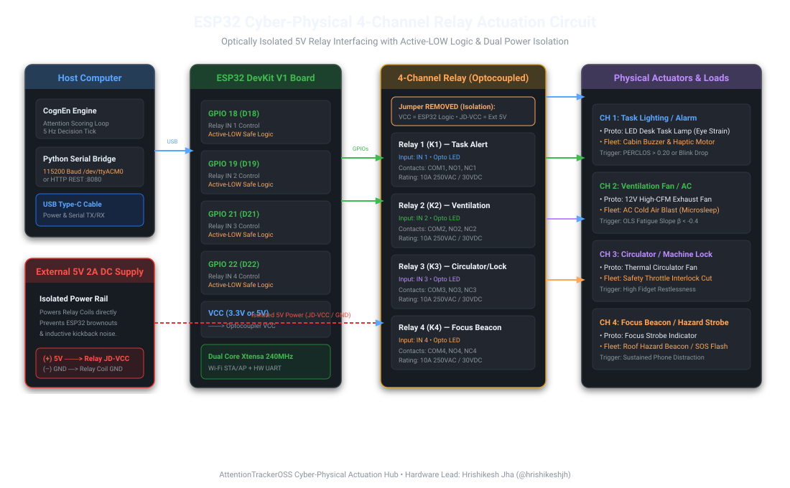

# AttentionTrackerOSS — Cyber-Physical Relay Control Hub

> **Lead Developer & Hardware Lead:** Hrishikesh Jha ([@hrishikeshjh](https://github.com/hrishikeshjh) · `hrishikeshjhapersonal@gmail.com`)  
> **Repository:** [AttentionTrackerOSS](https://github.com/hrishikeshjh/AttentionTrackerOSS)  
> **Project Heritage:** `TIH/RP/20` (Funded by iHUB Divyasampark, TIH IIT Roorkee under NM-ICPS)  
> **PIs:** Prof. Samiran Chattopadhyay & Prof. Dr. Mourani Sinha  

---

## 1. Overview & Mathematical Foundations

The **AttentionTrackerOSS Relay Control Hub** is a cyber-physical system (CPS) extension that interfaces real-time cognitive metrics directly to an **ESP32 microcontroller** controlling an optically isolated **4-Channel Relay module**.

It translates high-frequency eye analysis, head pose, fidget kinetics, and fatigue regression into physical actions (lighting adjustments, ventilation boosters, alarms, and emergency cut-offs) with sub-25ms response latency.



### Mathematical Core Implemented:
* **Eye Aspect Ratio (EAR):** $\frac{\|p_2 - p_6\| + \|p_3 - p_5\|}{2 \cdot \|p_1 - p_4\|}$ (Blink trigger $< 0.21$).
* **PERCLOS (Percentage Eye Closure):** Rolling 60s percentage of frames with $\text{EAR} < 0.21$.
* **Mouth Aspect Ratio (MAR):** Yawn detection and speech dynamics.
* **Head Pose Estimation:** 3D rotational Pitch ($+\text{down}$), Yaw (left/right), and Roll in degrees using SolvePnP.
* **Fidget & Restlessness:** Accumulated rotational velocity: $\sum (|\Delta \text{yaw}| + |\Delta \text{pitch}| + |\Delta \text{roll}|)$.
* **Fatigue Onset (OLS Regression):** Ordinary Least Squares slope $\beta < -0.4$ with $R^2 > 0.35$ over attention history.
* **Attention Score:** Multimodal weighted feature fusion smoothed via Exponential Moving Average:
  $$S_t = \alpha \cdot S_{\text{raw}} + (1 - \alpha) \cdot S_{t-1} \quad (\alpha = 0.15)$$
* **Context-Gate Override:** Resolves reading vs. phone ambiguity by prioritizing object context and hand-to-face distance.

---

## 2. Operating Modes & 4-Channel Relay Mapping

The system includes 4 specialized operating modes switchable directly from the UI or REST API:

| Relay Channel | Mode: `proto` (Study Desk & Classroom) | Mode: `truck` (Fleet & Heavy Machinery) | Mode: `exam` (Testing Hall & Kiosk) | Mode: `cleanroom` (Sterile Bio-Lab) |
| :---: | :--- | :--- | :--- | :--- |
| **Relay 1** (`GPIO 18`) | **Task Lighting** (Boosts on eye strain/reading) | **Cabin Buzzer & Haptic** (Immediate wake-up alert) | **Terminal Monitor Cut** (Instant blackout on phone breach) | **Robot / Pipette Cutoff** (Emergency stop on touch) |
| **Relay 2** (`GPIO 19`) | **Ventilation Fan** (Purges CO₂ on drowsiness) | **AC Cabin Blast** (Rapid cold airflow for microsleep) | **Proctor Silent Lamp** (Discreet desk alert to proctor) | **Laminar Flow Booster** (Increases positive pressure) |
| **Relay 3** (`GPIO 21`) | **Circulator Fan** (Thermal airflow on fidgeting) | **Throttle Interlock** (Cuts machine line on sleep) | **Solenoid Drawer Lock** (Secures personal belongings) | **Sterilization Air Shower** (Decontamination strobe) |
| **Relay 4** (`GPIO 22`) | **Focus Indicator** (Pulses on phone distraction) | **Hazard Beacon / SOS** (External warning & telematics) | **Seat Spotlight** (Compliance spotlight on seat) | **Airlock Door Interlock** (Biohazard barrier lock) |

---

## 3. Hardware Circuit & Pinout

```
[ External 5V 2A DC Power Supply ]
       ├── (+) ──> Relay Module JD-VCC (Optical Isolation)
       └── (–) ──> Relay Module GND (Coil Return)

[ ESP32 Dev Board ]
       ├── USB Cable ──> Laptop / Host PC (/dev/ttyACM0 or /dev/ttyUSB0)
       ├── GPIO 18 ──> Relay IN 1 (CH1: Task Lamp / Buzzer)
       ├── GPIO 19 ──> Relay IN 2 (CH2: Ventilation / AC Blast)
       ├── GPIO 21 ──> Relay IN 3 (CH3: Circulator Fan / Interlock)
       ├── GPIO 22 ──> Relay IN 4 (CH4: Focus Beacon / Strobe)
       ├── 3.3V/5V ──> Relay VCC (Logic opto anode)
       └── GND ──────> Relay GND
```

> **IMPORTANT:** Remove the `VCC-JD-VCC` jumper on the 4-channel relay board. Connect `JD-VCC` directly to the external 5V power supply to ensure full optical isolation and eliminate back-EMF spikes that could reset the ESP32.
>
> The firmware uses **Active-Low** logic ($0\text{V} = \text{Relay ON}$, $3.3\text{V} = \text{Relay OFF}$), matching standard optocoupled relay modules.

---

## 4. Quickstart Guide

### Step 1: Flash the ESP32 Firmware

#### Option A: Using Arduino IDE
1. Open `firmware/esp32_relay_controller/esp32_relay_controller.ino` in Arduino IDE.
2. Select **Tools > Board > ESP32 Dev Module**.
3. Set your Wi-Fi SSID and Password if using Over-The-Air mode (optional).
4. Click **Upload**.

#### Option B: Using PlatformIO
```bash
cd firmware/pio_project
pio run -t upload
```

### Step 2: Start the Web Hub & Serial Bridge
Run the single-line launcher:
```bash
./run.sh
```
Or start the Python bridge manually:
```bash
python3 python/server.py 8080
```
Open **`http://localhost:8080`** in Google Chrome, Microsoft Edge, or Brave.

### Step 3: Connect to Hardware
* **Wired (USB Serial):** Click **Connect USB** in the top navigation bar and select the serial port (e.g., `/dev/ttyUSB0` or `COM3`). No driver installation needed (uses native Web Serial API).
* **Wireless (Wi-Fi OTA):** Enter the ESP32 IP address shown in the Arduino Serial Monitor (e.g., `192.168.1.100`) and click **Wi-Fi**.
* **Simulation Mode:** If no ESP32 is plugged in, the system automatically runs in **Simulation Mode** with interactive virtual relay toggles.

---

## 5. Command Protocol Reference

### Serial Protocol (115200 Baud):
* `ALL:1001\n` — Sets channels 1 to 4 simultaneously (1 = ON, 0 = OFF).
* `CH1:1\n` / `CH1:0\n` — Direct channel control.
* `PULSE:4:2000\n` — Pulses channel 4 for 2000 ms then automatically reverts to OFF.
* `STATUS\n` — Requests current state: `STATE:1001\n`.
* `PING\n` — Heartbeat check; responds with `PONG\n`.

### Wi-Fi HTTP REST Endpoints:
* `GET http://<esp32-ip>/all?s=1001`
* `GET http://<esp32-ip>/relay?ch=1&state=1`
* `GET http://<esp32-ip>/pulse?ch=4&ms=2000`
* `GET http://<esp32-ip>/status`
* `GET http://<esp32-ip>/ping`

---

## 6. Testing & Hardware Diagnostics

To test relay actuation directly from the command line without launching the web dashboard:

```bash
# Run automated 4-channel test sequence
python3 python/test_relay.py
```
