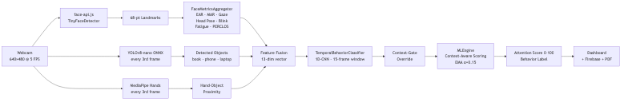
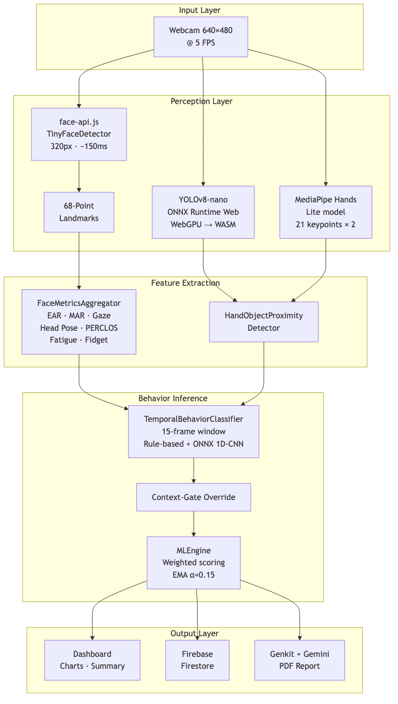
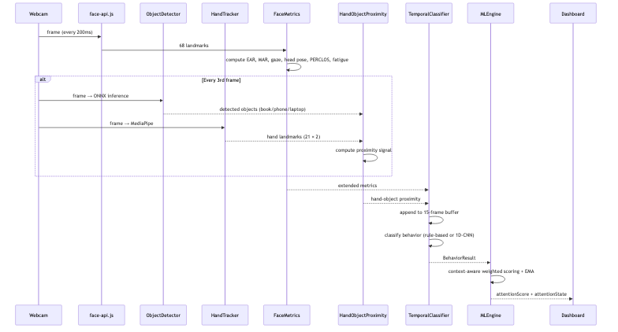
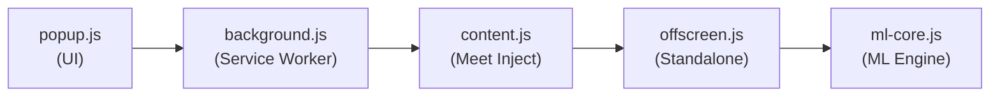

# CognEn v1.0 — Cognitive Engagement Analyzer (Browser)

> **Single-student, webcam-based real-time attention monitoring**
> For the multi-person CCTV server version, see **[v2.0 README](../v2.0/README.md)**.

---

## Table of Contents

1. [Overview](#1-overview)
2. [Key Features](#2-key-features)
3. [System Architecture](#3-system-architecture)
4. [ML Pipeline & Algorithms](#4-ml-pipeline--algorithms)
5. [Feature Extraction — Mathematical Foundations](#5-feature-extraction--mathematical-foundations)
6. [Object Detection Module (YOLOv8-nano)](#6-object-detection-module-yolov8-nano)
7. [Hand Tracking Module (MediaPipe Hands)](#7-hand-tracking-module-mediapipe-hands)
8. [Temporal Behavior Classifier (1D-CNN)](#8-temporal-behavior-classifier-1d-cnn)
9. [Context-Aware Scoring Engine](#9-context-aware-scoring-engine)
10. [Session Analytics Engine](#10-session-analytics-engine)
11. [Chrome Extension](#11-chrome-extension)
12. [Tech Stack](#12-tech-stack)
13. [Repository Structure](#13-repository-structure)
14. [Setup & Installation](#14-setup--installation)
15. [Configuration & Environment](#15-configuration--environment)
16. [Performance Metrics](#16-performance-metrics)
17. [Privacy](#17-privacy)
18. [References](#18-references)
19. [Cross-Reference: v2.0](#19-cross-reference-v20)

---

## 1. Overview

CognEn v1.0 is a **browser-based** cognitive engagement analyzer built on Next.js 15. It captures a webcam feed at 640×480 @ 5 FPS, runs face detection via **face-api.js TinyFaceDetector**, extracts 68 facial landmarks, and computes a real-time **attention score (0–100)** using a weighted multi-feature ML engine with EMA temporal smoothing.

The upgraded v1.0 adds **context-aware scoring**: YOLOv8-nano object detection, MediaPipe hand tracking, and a 15-frame sliding-window temporal classifier distinguish reading a book (attentive) from using a phone (distracted) — eliminating the uniform downward-gaze penalty of the original system.



---

## 2. Key Features

| Feature | Description |
|---------|-------------|
| **Context-Aware Attention** | Distinguishes phone use from book reading via YOLOv8-nano + MediaPipe hand tracking |
| **Temporal Classification** | 1D-CNN sliding-window (15 frames / 3 s) with 6 behavior classes |
| **Context-Gate Override** | Hard rule post-processor resolving phone/book ambiguity below confidence threshold |
| **12+ Biometric Features** | EAR, MAR, PERCLOS, gaze deviation, head pose, blink rate, fatigue index, fidget score |
| **Live Dashboard** | Real-time line chart, pie chart, multitasking counter, session summary |
| **PDF Reports** | AI-generated session reports via Google Genkit + Gemini |
| **Chrome Extension** | Manifest V3, works inside Google Meet / Zoom / Teams via offscreen document |
| **Firebase Auth** | Email/password + Google Sign-in, Firestore session storage |

---

## 3. System Architecture

### 3.1 High-Level Data Flow



### 3.2 Sequence Diagram



---

## 4. ML Pipeline & Algorithms

### 4.1 Two Scoring Modes

The MLEngine automatically selects its scoring mode:

| Mode | Condition | Features | Weights |
|------|-----------|----------|---------|
| **LEGACY** | `detectedObjects === undefined` | 13 features incl. uniform `pitchDeviation` | `FEATURE_WEIGHTS_LEGACY` |
| **UPGRADED** | `detectedObjects !== undefined` | 16 features: replaces `pitchDeviation` with `contextAwarePitch`, `objectContext`, `handObjectProximity`, `temporalPattern` | `FEATURE_WEIGHTS_V1_UPGRADED` |

### 4.2 Upgraded Feature Weights

| Feature | Weight | Role |
|---------|--------|------|
| gazeDeviation | 0.12 | Primary attention signal |
| contextAwarePitch | 0.12 | Pitch gated by object context |
| objectContext | 0.10 | What objects are visible |
| headPoseStability | 0.10 | Overall engagement |
| ear | 0.10 | Eye openness |
| perclos | 0.08 | Drowsiness |
| yawDeviation | 0.08 | Looking left/right |
| fatigueIndex | 0.07 | Accumulated fatigue |
| blinkRate | 0.05 | Eye strain indicator |
| handObjectProximity | 0.05 | Hand-object interaction |
| fidgetScore | 0.04 | Restlessness |
| temporalPattern | 0.03 | Temporal consistency bonus |
| mouthOpenness | 0.02 | Yawning detection |
| faceDistance | 0.02 | Proximity to camera |
| facePresence | 0.02 | Face in frame |

### 4.3 Score Computation

```
For each feature:
  score_i = scoreFeature(name, value)    // → 0–100
  quality_i = getQuality(name, value)    // → 0–1

Weighted combination:
  raw = Σ(score_i × weight_i × quality_i) / Σ(weight_i × quality_i)

EMA smoothing:
  smoothed = α × raw + (1 − α) × prev_smoothed    (α = 0.15)

Classification:
  ≥ 70 → Attentive
  ≥ 40 → Distracted
  < 40 → Multitasking
```

---

## 5. Feature Extraction — Mathematical Foundations

### 5.1 Eye Aspect Ratio (EAR)

```
EAR = (‖p2−p6‖ + ‖p3−p5‖) / (2 × ‖p1−p4‖)
```

| EAR Value | Interpretation |
|-----------|----------------|
| 0.30–0.40 | Fully open |
| 0.25–0.30 | Normal |
| 0.21–0.25 | Partially closed |
| < 0.21 | Blink / closed |

Blink detection: EAR drops below 0.21 then rises back, duration 50–500 ms.

### 5.2 PERCLOS (Percentage Eye Closure)

```
PERCLOS = (frames with EAR < 0.21) / (total frames in last 60s) × 100%
```

| PERCLOS | Interpretation |
|---------|----------------|
| < 15% | Alert |
| 15–30% | Mildly fatigued |
| > 30% | Drowsy |

### 5.3 Mouth Aspect Ratio (MAR)

```
MAR = ‖top_lip − bottom_lip‖ / ‖left_corner − right_corner‖
```

| MAR | Interpretation |
|-----|----------------|
| < 0.10 | Mouth closed |
| 0.10–0.25 | Speaking |
| > 0.25 | Yawning |

### 5.4 Head Pose Estimation

```
Yaw   = ((nose.x − eye_midpoint.x) / eye_distance) × 50°
Pitch = ((nose.y − eye_midpoint.y) / nose_chin_distance) × 50°
Roll  = atan2(right_eye.y − left_eye.y, right_eye.x − left_eye.x) × (180/π)
```

**Stability Score** (variance over 30-second window):
```
Stability = 100 − (σ²_yaw + σ²_pitch + 0.5 × σ²_roll) / 2.5 / 10
```

### 5.5 Gaze Direction

```
Gaze_X = ((iris_center.x − eye_center.x) / eye_width − 0.5) × 2
Gaze_Y = (eye_center.y − iris_center.y) / eye_height
Deviation = √(Gaze_X² + Gaze_Y²)
```

| Deviation | Interpretation |
|-----------|----------------|
| < 0.15 | Looking at screen |
| 0.15–0.30 | Slight glance |
| > 0.30 | Looking away |

### 5.6 Fatigue Index

Composite of three sub-scores (0–100):
```
PERCLOS_score   = clamp(avg_PERCLOS × 2, 0, 40)
Blink_score     = penalty if outside 15–20 bpm range (max 30)
EAR_trend_score = penalty if avg_EAR < 0.25 (max 30)
Fatigue_Index   = clamp(PERCLOS_score + Blink_score + EAR_trend_score, 0, 100)
```

### 5.7 Fidget Score

```
Movement = Σ|Δyaw| + |Δpitch| + |Δroll| over recent frames
Fidget   = clamp(avg_movement × 5, 0, 100)
```

---

## 6. Object Detection Module (YOLOv8-nano)

**Model**: YOLOv8-nano (3.2M params) via ONNX Runtime Web (WebGPU → WASM fallback)

| Property | Value |
|----------|-------|
| Input | `[1, 3, 640, 640]` float32, NCHW, normalized [0,1] |
| Output | `[1, 84, 8400]` (cx cy w h + 80 COCO class scores) |
| Confidence threshold | 0.25 |
| NMS IoU threshold | 0.45 |
| Inference cadence | Every 3rd frame |
| Target classes | laptop(63), mouse(64), keyboard(66), phone(67), book(73) |

**Post-processing**: Class-aware NMS — only suppresses overlapping boxes within the same class.

---

## 7. Hand Tracking Module (MediaPipe Hands)

| Property | Value |
|----------|-------|
| Model | MediaPipe Hands Lite (complexity 0) |
| Max hands | 2 |
| Landmarks | 21 per hand (normalized [0,1]) |
| Cadence | Every 3rd frame (same as ObjectDetector) |
| Min detection confidence | 0.5 |

**HandObjectProximityDetector** fuses hand centroids with object bounding boxes:
- Proximity threshold: 0.20 (normalized Euclidean distance)
- Priority order: `phone > book/notebook > pen`
- Output labels: `holding_phone`, `holding_book`, `holding_pen`, `hands_on_desk`, `hands_not_visible`

---

## 8. Temporal Behavior Classifier (1D-CNN)

### 8.1 Feature Vector (13 dimensions per frame)

| Index | Feature | Range |
|-------|---------|-------|
| 0 | gaze_x | [-1, 1] |
| 1 | gaze_y | [-1, 1] |
| 2 | pitch_norm (pitch/90) | [-1, 1] |
| 3 | yaw_norm (yaw/90) | [-1, 1] |
| 4 | ear | [0, 1] |
| 5 | perclos/100 | [0, 1] |
| 6 | head_pose_stability/100 | [0, 1] |
| 7 | has_book (one-hot) | {0, 1} |
| 8 | has_phone (one-hot) | {0, 1} |
| 9 | has_laptop (one-hot) | {0, 1} |
| 10 | has_none (one-hot) | {0, 1} |
| 11 | fidget_score/100 | [0, 1] |
| 12 | proximity_code | [0, 1] |

### 8.2 Behavior Classes

| Class | Attention Score | Description |
|-------|----------------|-------------|
| `attentive_screen` | 85 | Watching lecture / screen |
| `attentive_reading` | 80 | Reading book / notes |
| `distracted` | 45 | Looking around, talking |
| `using_phone` | 25 | Phone distraction |
| `drowsy` | 20 | Head down + low EAR |
| `absent` | 0 | Face not in frame |

### 8.3 Two-Tier Classification

1. **Rule-based fallback** — always available, used when < 15 frames buffered or no ONNX model
2. **ONNX 1D-CNN** — trained model loaded via `loadModel()`, input `[1, 15, 13]`

### 8.4 Rule-Based Decision Tree

```
1. face_area < 0.005         → absent     (conf 1.0)
2. EAR < 0.22 AND PERCLOS > 20 → drowsy   (conf 0.85)
3. phone + (holding OR looking down) → using_phone (conf 0.80)
4. book + (holding OR looking down) → attentive_reading (conf 0.75)
5. gaze_deviation < 0.3 AND |pitch| < 15° → attentive_screen (conf 0.70)
6. else → distracted (conf 0.60)
```

---

## 9. Context-Aware Scoring Engine

### 9.1 Context-Aware Pitch Score

Replaces the uniform pitch penalty:

```
if pitch < -15°:
    if phone detected or holding_phone → 20 (distracted)
    if book detected or holding_book  → 85 (attentive)
    if EAR < 0.22 and PERCLOS > 20   → 15 (drowsy)
    else                              → 40 (unknown)
else:
    standard pitch scoring based on deviation from optimal ±15°
```

### 9.2 Object Context Score

```
No objects       → 65 (neutral)
Phone visible    → 25
Book + pitch<-10 → 80
Book (other)     → 70
Laptop + |pitch|<15 → 80
Other            → 65
```

### 9.3 Hand Proximity Encoding

| Proximity | Score |
|-----------|-------|
| holding_book | 80 |
| holding_pen | 75 |
| hands_on_desk | 65 |
| hands_not_visible | 60 |
| holding_phone | 20 |

---

## 10. Session Analytics Engine

Uses **linear regression** for trend detection, sliding windows for period identification.

| Algorithm | Purpose |
|-----------|---------|
| Linear regression (OLS) | Attention trend (slope + R²) |
| Period detection | Find contiguous high (≥75) / low (≤45) periods |
| Fatigue onset detection | Sustained declining slope (< -0.5) + R² > 0.4 + avg < 60 |
| Anomaly detection | Z-score > 2.5 σ from mean; sudden drops > 30 points |
| Optimal window | Sliding window finding highest average attention period |

---

## 11. Chrome Extension

**Manifest V3** extension with dual-mode operation:



| Mode | When | How |
|------|------|-----|
| **Meet Mode** | On Google Meet tab | Injects into page, reads existing video element |
| **Standalone** | Not on Meet | Uses offscreen document with own camera access |

**Score Interpretation**: 70–100 (Green/Attentive) · 40–69 (Orange/Distracted) · 0–39 (Red/Multitasking)

---

## 12. Tech Stack

| Layer | Technology |
|-------|------------|
| Framework | Next.js 15 (App Router, Turbopack) |
| Face detection | face-api.js TinyFaceDetector (320px, ~150ms) |
| Landmarks | face-api.js 68-point model (iBUG convention) |
| Object detection | YOLOv8-nano ONNX via `onnxruntime-web` (WebGPU → WASM) |
| Hand tracking | MediaPipe Hands Lite (`@mediapipe/hands`) |
| Temporal classifier | Rule-based + ONNX 1D-CNN |
| Auth / Storage | Firebase Auth + Firestore |
| AI report | Google Genkit + Gemini (PDF generation) |
| Charts | Recharts |
| UI components | Radix UI + Tailwind CSS |
| Extension | Chrome MV3 + offscreen document |

---

## 13. Repository Structure

```
v1.0/
├── src/
│   ├── lib/
│   │   ├── types.ts               # Core types: ExtendedFaceMetrics, BehaviorResult, etc.
│   │   ├── face-geometry.ts       # EAR/MAR, BlinkDetector, HeadPoseTracker,
│   │   │                          #   FatigueCalculator, HandObjectProximityDetector
│   │   ├── ml-engine.ts           # MLEngine: context-aware scoring, FEATURE_WEIGHTS
│   │   ├── object-detector.ts     # YOLOv8-nano ONNX wrapper (browser)
│   │   ├── hand-tracker.ts        # MediaPipe Hands wrapper (browser)
│   │   ├── temporal-classifier.ts # 1D-CNN sliding-window classifier (browser)
│   │   ├── analytics.ts           # SessionAnalyticsEngine
│   │   └── firebase.ts            # Firebase config
│   ├── components/
│   │   ├── dashboard/             # Webcam panel, charts, session summary
│   │   ├── auth-form.tsx          # Login / signup
│   │   └── ui/                    # Radix UI primitives
│   ├── app/
│   │   ├── page.tsx               # Landing / auth page
│   │   ├── dashboard/             # Main dashboard route
│   │   └── globals.css            # Global styles
│   ├── ai/flows/                  # Genkit flows (session summary, PDF report)
│   └── hooks/                     # React hooks
├── extension/
│   ├── lib/ml-core.js             # JS port: MLEngineV2, TemporalBehaviorClassifier
│   ├── offscreen.js               # Offscreen document: webcam + face-api.js
│   ├── background.js              # Service worker
│   ├── content.js                 # Injects attention widget into Meet/Zoom/Teams
│   └── manifest.json              # Chrome MV3 manifest
├── public/
│   ├── models/                    # face-api.js weights
│   └── onnx/                      # onnxruntime-web WASM binaries
├── scripts/
│   └── setup-models.sh            # Copies WASM from node_modules
├── package.json
├── next.config.ts
├── tailwind.config.ts
└── tsconfig.json
```

---

## 14. Setup & Installation

### Prerequisites
- Node.js ≥ 20
- Firebase project (Auth + Firestore)
- Google AI API key (Genkit / Gemini)

### Steps

```bash
# 1. Install dependencies
cd v1.0 && npm install

# 2. Environment variables
cp .env.example .env.local
# Edit with Firebase + Genkit keys (see §15)

# 3. ONNX Runtime WASM binaries
bash scripts/setup-models.sh

# 4. YOLOv8-nano model (on a machine with Ultralytics)
python3 -c "from ultralytics import YOLO; YOLO('yolov8n.pt').export(format='onnx', imgsz=640, opset=17, simplify=True)"
cp yolov8n.onnx v1.0/public/models/yolov8n-objects.onnx

# 5. Dev server
npm run dev    # → http://localhost:9002

# 6. Chrome Extension (optional)
# chrome://extensions → Developer mode → Load unpacked → select extension/
```

### Available Commands

```bash
npm run dev           # Dev server (Turbopack, port 9002)
npm run build         # Production build
npm run lint          # ESLint
npm run typecheck     # TypeScript type check
npm run genkit:dev    # Genkit AI dev server
```

---

## 15. Configuration & Environment

```
NEXT_PUBLIC_FIREBASE_API_KEY=...
NEXT_PUBLIC_FIREBASE_AUTH_DOMAIN=...
NEXT_PUBLIC_FIREBASE_PROJECT_ID=...
NEXT_PUBLIC_FIREBASE_STORAGE_BUCKET=...
NEXT_PUBLIC_FIREBASE_MESSAGING_SENDER_ID=...
NEXT_PUBLIC_FIREBASE_APP_ID=...
GOOGLE_GENAI_API_KEY=...
```

---

## 16. Performance Metrics

| Metric | Value |
|--------|-------|
| Frame rate | 5 FPS (~200ms intervals) |
| Face detection | TinyFaceDetector, 320px input, ~150ms |
| Memory | ~50MB for face-api models |
| CPU usage | ~15–25% on modern hardware |
| Latency target | < 200ms/frame |
| Object detection | ~15ms/frame (WebGPU) |

### Accuracy Limitations

- Poor lighting reduces landmark accuracy
- Extreme head angles (>40°) lose tracking
- Reflective glasses affect gaze estimation
- Only first detected face is tracked (single-user)
- Low-res cameras reduce accuracy

---

## 17. Privacy

1. **All processing local** — no video data sent to any server
2. **No raw video stored** — only derived scores persisted
3. **Extension data** — stored locally in Chrome's storage
4. **Firebase** — only attention scores + timestamps, never video

---

## 18. References

- **EAR**: Soukupová & Čech (2016) — *Real-Time Eye Blink Detection using Facial Landmarks*
- **PERCLOS**: Dinges & Grace (1998) — *PERCLOS: A Valid Psychophysiological Measure of Alertness*
- **face-api.js**: https://github.com/vladmandic/face-api
- **68-Point Landmarks**: iBUG 300-W dataset standard
- **YOLOv8**: Ultralytics (2023) — https://github.com/ultralytics/ultralytics
- **MediaPipe Hands**: Google (2020) — https://developers.google.com/mediapipe

---

## 19. Cross-Reference: v2.0

v1.0's per-person analysis pipeline is **reused as the core of v2.0**. See the [v2.0 README](../v2.0/README.md) for the multi-person CCTV server system.

| Component | v1.0 | v2.0 |
|-----------|------|------|
| Face detection | face-api.js | YOLOv8-m + MediaPipe FaceMesh |
| 68-pt landmarks | face-api.js | MediaPipe → ibug mapping |
| EAR/MAR/Gaze/HeadPose | TypeScript (browser) | Python port |
| Object detection | YOLOv8-nano (ONNX.js) | YOLOv8-s (Ultralytics) |
| Hand tracking | MediaPipe Hands (browser) | Pose covers this |
| Temporal classifier | 1D-CNN (browser ONNX) | 1D-CNN (server ONNX) |
| Tracking | Single person | ByteTrack multi-person |
| Seat mapping | N/A | Shapely polygon IoU |
| Deployment | Browser / Chrome Extension | FastAPI + GPU server |